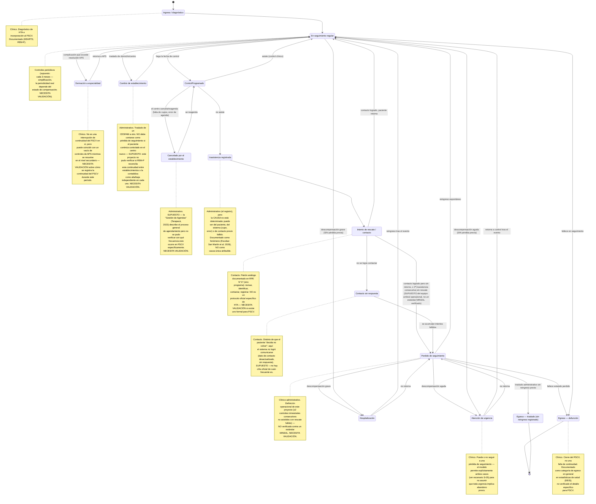

# Modelo de trayectoria asistencial — validación conceptual

Fase de trabajo: validación conceptual del recorrido asistencial en APS chilena (hipertensión arterial, PSCV), iniciada y pausada a mitad de camino el 17 de noviembre de 2026 por una solicitud de rediseño visual, y retomada el mismo día. El trabajo de código de esta fase (vocabulario de eventos clínico/administrativo/contacto, gancho de pruebas) ya estaba incorporado al prototipo antes de la pausa; esta fase completa la investigación, el mapa formal, los escenarios, las pruebas funcionales y las preguntas de validación.

**Importante:** este documento es una propuesta de modelo conceptual para contrastar con la operación real de un CESFAM. **No está validado clínicamente.** Nada aquí debe tratarse como una descripción confirmada de cómo funciona el PSCV en la práctica hasta que profesionales de APS lo revisen (ver sección 6).

---

## 1. Investigación: qué dice la documentación oficial

Fuentes revisadas en esta fase (además del catálogo de `docs/catalogo_fuentes.md`):

| Documento | Qué aporta | Estado |
|---|---|---|
| MINSAL, *RPE N°12 — Criterios técnicos para la programación de actividades del programa cardiovascular en Atención Primaria* (2026) | Confirma que la programación de actividades del PSCV sigue la "orientación técnica vigente" del programa, sin reproducir su contenido clínico completo. | Real, descargado (`research/guidelines/RPE12_Criterios_Programacion_PSCV.pdf`). |
| MINSAL, *RPE N°17 — Adolescente en Atención Primaria* (2026) | No es sobre PSCV ni HTA, pero documenta un **patrón de rescate oficial de otro programa**: revisar la población bajo control, identificar a quienes faltaron a su control, contactarlos, registrar si se logró contacto ("trazabilidad") y priorizar a las personas de mayor riesgo. Se usa aquí como **analogía documentada**, no como protocolo específico de HTA. | Real, descargado (`research/guidelines/RPE17_Adolescente_APS_2026.pdf`). |
| HEARTS Chile — documento MINSAL 2026, presentación PAHO 2019, ficha técnica PAHO Área 2 | Describen el protocolo clínico simplificado (diagnóstico, umbral de PA, esquema de tratamiento, verificación de compensación) y resultados de control poblacional. **No describen** un flujo administrativo de inasistencia/rescate/derivación — HEARTS es un paquete clínico-terapéutico, no un modelo de gestión de agenda. | Real, descargados. |
| *Hypertension care cascade in Chile* (encuestas nacionales 2003-2010-2017, PMC7490861) | Modelo de "cascada de atención" (conciencia diagnóstica → tratamiento → control), de corte transversal poblacional. **No modela trayectorias longitudinales ni pérdida de seguimiento entre etapas** — es un hallazgo metodológico relevante: no existe, en la literatura revisada, un modelo longitudinal oficial de continuidad para HTA en Chile. | Real, revisado (no descargado como PDF; consultado vía su texto completo). |
| Escobar-San Martín, Droguett Droguett & Sabando Franulic (2026), BMC Primary Care — inasistencia en Renca | Estudio transversal de determinantes **sociodemográficos y administrativos** de la inasistencia a citas en APS chilena — respalda que la inasistencia tiene causas más allá del paciente (sexo, edad, tipo de cita, antigüedad de la cita agendada). | Real, descargado. |
| Barake et al. (2022), *HEARTS implementation* | Confirma la mejora de compensación poblacional (16%→33%) **tras** implementar HEARTS, pero sobre datos agregados de REM, no sobre trayectorias individuales. | Real, descargado. |
| MINSAL, *Gestión de Agendas* (presentación Servicio de Salud Tarapacá, 2023) | Describe en general el proceso de agendamiento (asignación de cupos por criterios de priorización de demanda) y de gestión de citas (confirmación telefónica). Relevante para los eventos administrativos del mapa (sección 2), pero **no se pudo descargar** en esta sesión (el servidor de origen cortó la conexión repetidamente, igual que en la etapa de catálogo de fuentes). | Localizado, no descargado — ver limitación más abajo. |

### Hallazgo metodológico central de esta investigación

**No existe, en ninguna de las fuentes oficiales revisadas, un modelo longitudinal único y explícito de "trayectoria del paciente hipertenso en el PSCV"** que cubra programación, inasistencia, rescate, derivación y pérdida de seguimiento en una sola pieza. Lo que existe son fragmentos: HEARTS define el protocolo clínico; RPE N°12 define la programación de actividades; RPE N°17 (de otro programa) ilustra cómo se documenta el rescate; la cascada de atención mide resultados poblacionales sin trayectoria. **El mapa de la sección 2 es, por lo tanto, una síntesis construida por el equipo a partir de esos fragmentos — no la transcripción de un documento único**, y así debe presentarse a cualquier profesional de APS que lo revise.

---

## 2. Mapa formal de la trayectoria asistencial



### Lectura del mapa

- Hay **dos puntos de entrada a `PerdidoSeguimiento`** que no requieren pasar por una inasistencia explícita: una urgencia/hospitalización sin retorno, y un traslado administrativo sin reingreso confirmado. El generador sintético actual (`prototipo/index.html`, bloque `MODEL`) solo modela la vía de inasistencia repetida — ver la sección 5 sobre qué no cubre el generador.
- `Urgencia` y `Hospitalizacion` tienen una transición de entrada **tanto desde `EnSeguimiento` como desde `PerdidoSeguimiento`**, deliberadamente, para no asumir que todo evento agudo implica abandono previo (instrucción explícita de esta fase, punto 3).
- `CanceladoPorEstablecimiento` y `ContactoFallido` son los dos estados que existen específicamente para que una interrupción administrativa o de contacto no se registre, visualmente ni conceptualmente, igual que una decisión del paciente.

---

## 3. Diccionario de eventos

Mismos 16 tipos de evento que `EVENT_META` en `prototipo/index.html` (única fuente de verdad: esta tabla describe el código, no al revés).

| Evento | Categoría | Condición de entrada | Condición de salida / efecto | Lo produce el generador aleatorio |
|---|---|---|---|---|
| `ingreso` | Clínico | Diagnóstico de HTA confirmado | Abre la trayectoria; fija el mes 0 del paciente | Sí |
| `control` | Clínico | Fecha de control programada y el paciente asiste | Registra `compensado: true/false`; resetea el contador de inasistencias consecutivas | Sí |
| `no_asistio` | Administrativo (causa no determinada) | Fecha de control programada y el paciente NO asiste | Incrementa el contador de inasistencias consecutivas; programa un intento de rescate al mes siguiente | Sí |
| `rescate_exitoso` | Contacto | Intento de contacto tras una inasistencia, logrado | Vuelve a `EnSeguimiento`; resetea el contador | Sí |
| `rescate_fallido` | Contacto | Intento de contacto tras una inasistencia, no logrado o sin retorno | Si es la 2ª vez consecutiva, dispara `perdido` | Sí |
| `perdido` | Clínico (clasificación del modelo) | 2 inasistencias consecutivas con rescate fallido (umbral propio del proyecto) | Abre un episodio de pérdida; empieza a acumular riesgo mensual de evento adverso | Sí |
| `reingreso` | Contacto | Paciente perdido retoma el seguimiento sin mediar un evento adverso | Cierra el episodio de pérdida | Sí |
| `urgencia` | Clínico | Evento agudo cardiovascular, con o sin pérdida previa | Puede o no ir seguido de `reingreso_post_evento` | Sí |
| `hospitalizacion` | Clínico | Evento agudo grave, con o sin pérdida previa | Puede o no ir seguido de `reingreso_post_evento` | Sí |
| `reingreso_post_evento` | Clínico | Tras una urgencia/hospitalización mientras el paciente estaba perdido | Cierra el episodio de pérdida | Sí |
| `cancelado_establecimiento` | Administrativo | El centro cancela o reagenda el control (falta de cupos, error) | El control se pospone; NO cuenta como inasistencia del paciente | **No** — añadido para los escenarios de esta fase |
| `contacto_fallido` | Contacto | Intento de rescate donde el sistema no logra comunicarse (no es que el paciente rechace) | Se acumula como intento sin resultado | **No** |
| `derivacion_especialidad` | Clínico | Complicación que excede la resolución de APS | Abre un período de manejo en nivel secundario; se espera retorno a APS | **No** |
| `derivacion_establecimiento` | Administrativo | Traslado de domicilio/centro de atención | Cambia el establecimiento de registro; continuidad clínica no debería interrumpirse | **No** |
| `egreso_defuncion` | Clínico | Fallecimiento del paciente | Cierra la trayectoria. **No es pérdida de seguimiento** | **No** |
| `egreso_traslado` | Administrativo | Cierre administrativo del registro en este establecimiento (traslado sin reingreso confirmado) | Cierra la trayectoria en este centro. **No es pérdida de seguimiento ni abandono** | **No** |

Los 6 eventos marcados "No" en la última columna existen en el código (`EVENT_META`, `patientStatus()`) desde la extensión de vocabulario de esta fase, pero el generador aleatorio de 420 pacientes **no los produce** — ver sección 5.

---

## 4. Qué transiciones están documentadas, cuáles son supuestos, y cuáles necesitan validación

| Transición / regla | Estado de evidencia | Detalle |
|---|---|---|
| Ingreso al PSCV tras diagnóstico de HTA | **Documentado** | HEARTS, REM-P. |
| Verificación de compensación en cada control | **Documentado** | HEARTS (umbral de PA), REM-P (variable "compensado"). |
| Periodicidad de controles cada 3 meses para todos los pacientes | **Supuesto del proyecto** | Simplificación explícita — HEARTS y la literatura de PSCV indican que la periodicidad real depende del estado de compensación (más frecuente si no está compensado). |
| Umbral de "pérdida de seguimiento" = 2 controles trimestrales consecutivos sin rescate | **Supuesto del proyecto** | Definición operacional elegida para que el modelo sea computable; no es un estándar MINSAL verificado. |
| Existencia de un proceso de rescate de inasistentes (revisión, identificación, contacto, registro) | **Documentado por analogía**, no específico de HTA | RPE N°17 lo documenta para adolescentes; se asume (sin verificar) un patrón similar para PSCV. |
| Probabilidad de que el rescate funcione | **Supuesto del proyecto, con referencia indirecta** | El generador usa valores arbitrarios (22%-52% según establecimiento); Werner et al. (2023) da evidencia de que los recordatorios funcionan, con intervalos amplios, pero no da una tasa chilena específica de PSCV. |
| Cancelación de controles por falta de cupos del establecimiento | **Supuesto, documentación parcial no verificada** | La presentación de "Gestión de Agendas" (Tarapacá, 2023) describe el proceso general de agendamiento, pero no se pudo descargar ni confirmar su frecuencia en PSCV. |
| Urgencia/hospitalización posible sin pérdida de seguimiento previa | **Documentado conceptualmente, no cuantificado** | Es clínicamente obvio que un evento agudo puede ocurrir en un paciente bien controlado; ninguna fuente revisada cuantifica esta proporción para HTA en Chile. |
| Continuidad tras cambio de establecimiento (¿se reconcilia o se cuenta como alta/baja independiente?) | **Necesita validación** | No se encontró ninguna fuente que explique cómo REM-P trata a un paciente que se traslada de CESFAM. |
| Egreso por defunción como categoría distinta de "pérdida" | **Documentado como categoría general de salud, no específico de PSCV** | DEIS distingue tipos de egreso hospitalario (ver `docs/diccionario_variables.md`); no se confirmó si REM-P tiene un campo equivalente para el PSCV. |
| Relación entre pérdida de seguimiento y riesgo de evento adverso | **Supuesto explícito del generador, no una medición real** | Ver `docs/auditoria_metodologica.md` y la tabla de "Supuestos explícitos" en la pestaña Fuentes del prototipo. |

---

## 5. Qué no modela el generador aleatorio (alcance declarado)

El generador de 420 pacientes (auditado en noviembre, `docs/auditoria_metodologica.md`) solo produce las vías de: ingreso → control/inasistencia → rescate → pérdida → urgencia/hospitalización → reingreso. **No genera** cancelaciones administrativas, contactos fallidos, derivaciones, ni egresos por defunción o traslado — esos 6 eventos existen en el vocabulario del código para que los **escenarios manuales** de la sección 6 puedan representarse en la vista de Trayectorias, pero la cohorte aleatoria de 420 pacientes no los contiene. Esto es una limitación declarada, no un error: extender el generador aleatorio para producir estas vías es un trabajo futuro razonable, pero no se hizo en esta fase para no reabrir el generador ya auditado y con sus 33 pruebas en verde.

---

## 6. Escenarios de pacientes sintéticos (12)

Casos complejos diseñados a mano para poner a prueba la vista de Trayectorias más allá de lo que el generador aleatorio típicamente produce. Definidos en `prototipo/test_trayectorias.mjs` (código fuente exacto) y resumidos aquí:

| ID | Caso | Por qué importa |
|---|---|---|
| S-01 | Continuidad regular, sin incidentes | Caso base. |
| S-02 | Una inasistencia aislada, rescate exitoso, nunca llega a "perdido" | Verifica que un rescate temprano no se confunda con una pérdida. |
| S-03 | Dos episodios de pérdida separados por un reingreso espontáneo | Ciclos múltiples (instrucción explícita de esta fase) — **este escenario detectó un bug real**, ver sección 7. |
| S-04 | Pérdida prolongada con hospitalización y reingreso post-evento | Un evento adverso como vía de reenganche. |
| S-05 | Urgencia **sin** abandono previo, en paciente con buena continuidad | Evita asumir que toda urgencia implica pérdida previa (instrucción explícita). |
| S-06 | Control atrasado por falta de disponibilidad del establecimiento | Interrupción administrativa, no inasistencia del paciente. |
| S-07 | Cambio de establecimiento sin interrupción de continuidad | Traslado administrativo "limpio". |
| S-08 | Derivación a especialidad por complicación, con retorno a APS | Distingue derivación clínica de pérdida de seguimiento. |
| S-09 | Intento de rescate sin respuesta (falla de contacto, no del paciente) | Causa administrativa/de sistema explícita, termina en pérdida. |
| S-10 | Egreso por defunción | No debe registrarse como pérdida de seguimiento. |
| S-11 | Egreso por traslado tras una pérdida previa | Cierre administrativo que no debe leerse como abandono activo continuo. |
| S-12 | Compensación persistentemente mala, sin ningún episodio de pérdida | Compensación y continuidad son ejes distintos — un paciente puede asistir siempre y no compensarse nunca. |

---

## 7. Pruebas funcionales sobre la vista de Trayectorias

**Herramienta:** `prototipo/test_trayectorias.mjs`, Playwright (Chromium real, no simulado), inyectando cada escenario mediante `window.__APS_TEST__` — el mismo gancho de prueba agregado al código en la primera mitad de esta fase. Para cada escenario se verifica: que se pueda agregar y seleccionar sin excepción, que el panel de detalle quede visible, que el estado clasificado (`patientStatus()`) coincida con lo esperado, que la cronología muestre exactamente un ítem por evento, que ningún evento se etiquete como `"undefined"` (cobertura completa de `EVENT_META`), y que el SVG dibuje un círculo por evento. Al final, que ningún escenario haya generado un error de consola.

**Ejecución:** `NODE_PATH=/opt/node-tools/node_modules node test_trayectorias.mjs` (el entorno expone Playwright fuera de la resolución estándar de Node; con `NODE_PATH` resuelve igual que `test_generador.mjs` resuelve su extracción de `index.html`).

### Resultado

```
=== APS Continuidad — pruebas funcionales de Trayectorias ===
12 escenarios, inyectados vía window.__APS_TEST__ en un Chromium real.
...
=== Resultado: 73 pruebas OK, 0 fallidas ===
```

### Bug real encontrado y corregido por estas pruebas

El escenario **S-03** (dos episodios de pérdida, ambos cerrados por reingreso espontáneo, sin ningún evento `rescate_exitoso`) reveló que `patientStatus()` solo reconocía como "Rescatado, activo" a un paciente si existía un evento `rescate_exitoso` en su historial. Un paciente que se recupera de una pérdida **sin** que medie un rescate (reingreso espontáneo, `ASSUMPTIONS.spontaneousReengagePerDueMonth` en el generador real) quedaba mal clasificado como "Sin episodios de pérdida" — falso, dado que si tuvo episodios. Un segundo escenario (**S-02**: una inasistencia aislada, rescatada, que nunca llega a "perdido") mostró el caso inverso: ahí sí hay un evento `rescate_exitoso` pero `episodesLost` es 0. La corrección final usa ambas señales (`episodesLost>0 OR algún rescate_exitoso`), documentada en el propio código (`prototipo/index.html`, función `patientStatus`). **Esto afecta a la cohorte aleatoria real**, no solo a los escenarios de prueba: cualquier paciente generado que se recuperó espontáneamente de una pérdida sin un rescate documentado estaba mal etiquetado antes de esta corrección. Verificado que las 33 pruebas de `test_generador.mjs` siguen en verde (la corrección es puramente de clasificación visual, no toca `AGG` ni ningún indicador numérico).

---

## 8. Preguntas concretas para profesionales de CESFAM (validación, noviembre 2026)

Organizadas por tema, pensadas para una conversación breve (no una encuesta larga) con un equipo de APS real.

**Sobre periodicidad y definición de pérdida**
1. ¿Cada cuánto se cita realmente a un paciente HTA del PSCV — es siempre cada 3 meses, o cambia según si está compensado o no?
2. ¿Existe un número de inasistencias consecutivas que el propio equipo considere "se perdió el seguimiento", aunque no esté escrito en ningún documento? ¿Cuál es, en la práctica?
3. ¿Un paciente que falta una vez y se rescata al toque se registra distinto de uno que nunca faltó?

**Sobre rescate y contacto**
4. ¿Quién hace el rescate (administrativo, TENS, enfermera) y con qué herramienta (llamada, visita domiciliaria, mensaje)?
5. ¿Qué pasa cuando el teléfono registrado ya no sirve — hay un protocolo, o simplemente queda "sin resultado"?
6. ¿Existe algún criterio de priorización de rescate por riesgo clínico, como el que describe RPE N°17 para otro programa?

**Sobre causas administrativas**
7. ¿Con qué frecuencia el propio CESFAM cancela o reagenda un control por falta de horas/cupos? ¿Eso se registra en algún sistema, o se pierde?
8. ¿Una inasistencia "administrativa" (el centro no tenía cupo, hubo un error de agenda) se distingue en el registro de una inasistencia del paciente?

**Sobre derivación y traslados**
9. Si un paciente se cambia de CESFAM, ¿su continuidad se transfiere de alguna forma, o queda como alta en un centro y como paciente nuevo en el otro?
10. ¿Qué pasa con el seguimiento PSCV mientras un paciente está en proceso de derivación a especialidad por una complicación?

**Sobre egresos**
11. ¿Cómo se registra la defunción de un paciente del PSCV — se "da de baja" de una forma distinguible de un abandono?

**Sobre el modelo en general**
12. Mirando el diagrama de la sección 2: ¿hay algún camino que les parezca equivocado, o algún camino importante que falte?
13. De los eventos adversos (urgencia, hospitalización): en su experiencia, ¿ocurren más seguido en pacientes que ya habían perdido seguimiento, o la relación no es tan clara como el generador sintético la muestra?

---

## 9. Resumen de archivos de esta fase

- `prototipo/index.html` — vocabulario de 6 eventos nuevos y corrección de `patientStatus()` (ya en el repo desde la primera mitad de esta fase + el fix de esta segunda mitad).
- `prototipo/test_trayectorias.mjs` — 12 escenarios + 73 pruebas funcionales (nuevo).
- `docs/modelo_trayectoria_aps.md` — este documento (nuevo).

No se agregaron vistas nuevas ni se modificó el diseño visual del rediseño anterior, por instrucción explícita de esta fase.
